# #99 review fixes: unknown scheduled change, platform 503 pages

Built with `CONTENT_SOURCE=sample BUILD_NOW=2026-11-01T12:00:00+01:00`, clock fixed at 19th November 2026. **Every API answer is a mock** (Playwright `route.fulfill`): no real Stripe, session or sponsor data.

Full-page screenshots at 320, 375, 390, 1280 and 1440 px with reduced motion. [`checks.json`](checks.json): 35 captures, no horizontal overflow, Figtree rendered, no page errors, 3 px focus ring on the keyboard-focused Check again.

| State | What it shows | 390 | 1440 |
| --- | --- | --- | --- |
| `plan-form-unknown-schedule` | Scheduled change unknown, Monthly chosen (a change from the renewal): no confirm button, Check again | 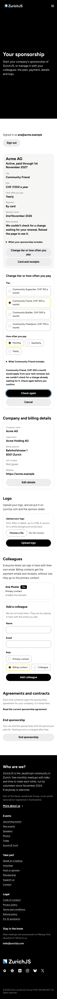 | 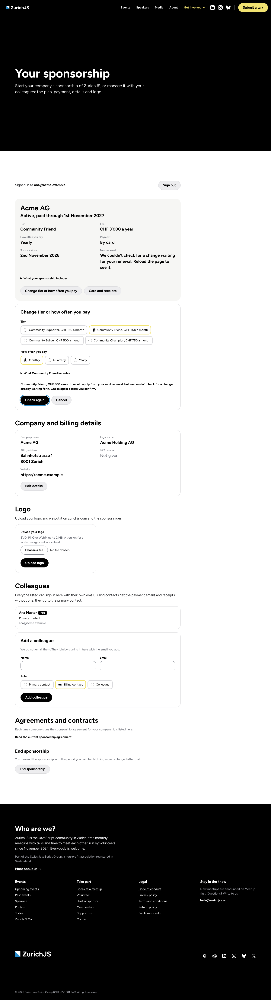 |
| `plan-form-after-check-again` | Check again got a known answer: the confirmation is offered | 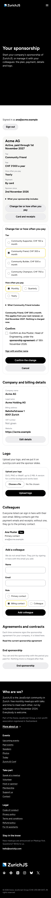 | 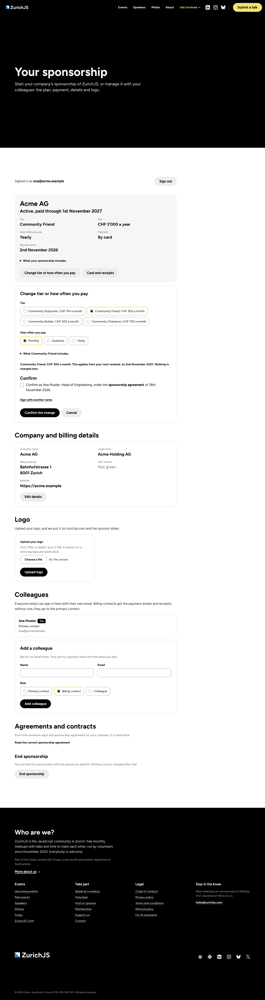 |
| `change-link-unknown-schedule` | `?change=friend-monthly` while unknown: the linked form waits too | 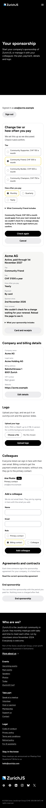 | 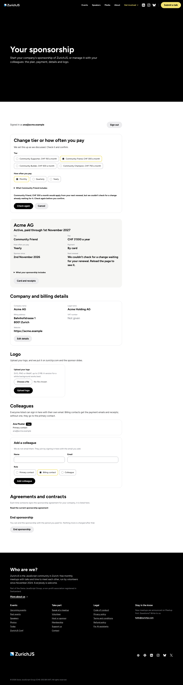 |
| `sponsor-platform-503` | HTML 503 from the platform: error with Try again | 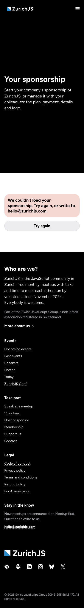 |  |
| `sponsor-not-configured-503` | The route's own JSON 503: "not available yet" (unchanged) | 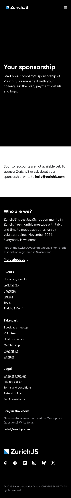 | 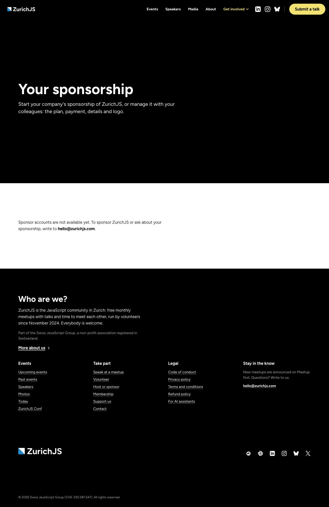 |
| `member-platform-503` | Member account, HTML 503: error with Try again | 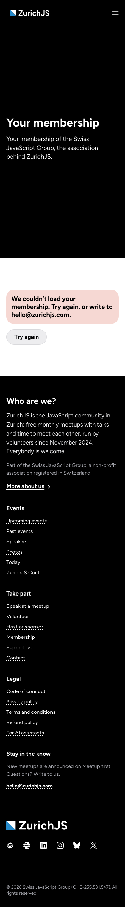 | 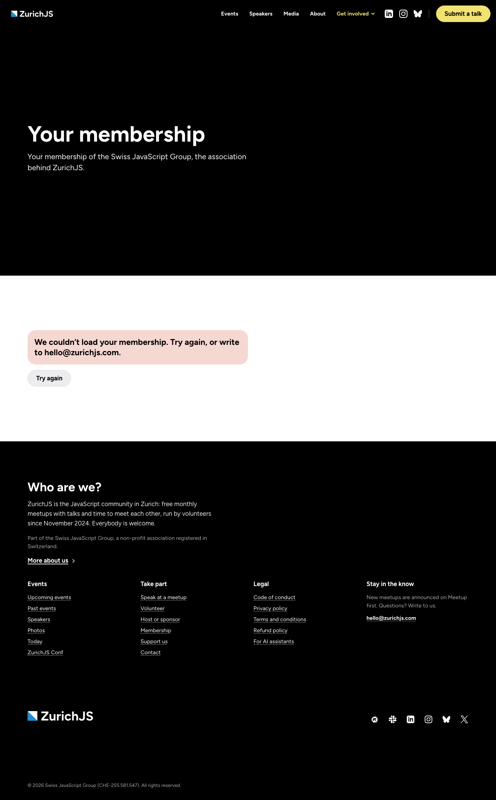 |
| `sponsor-no-answer-20s` | No answer for 20 s (fake clock): Try again | 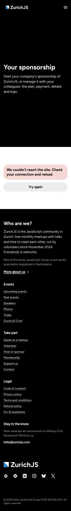 | 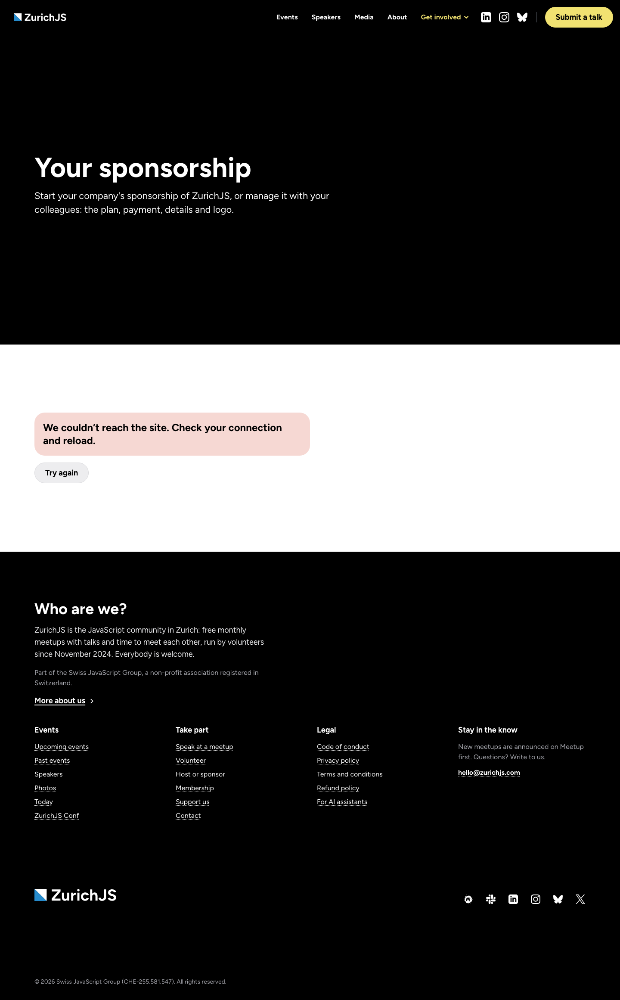 |

Recordings (1280 × 800, motion on, mocked answers): [`plan-form-unknown-then-check-again.mp4`](plan-form-unknown-then-check-again.mp4) ([gif](plan-form-unknown-then-check-again.gif)) and [`platform-503-then-try-again.mp4`](platform-503-then-try-again.mp4) ([gif](platform-503-then-try-again.gif)).

Fail before: [`e2e-on-old-head-33bd107.log`](e2e-on-old-head-33bd107.log) (8 of 12 selected browser tests fail; the 20 s deadline tests pass on both, as new coverage of the original request's deadline), [`unit-on-old-head-33bd107.log`](unit-on-old-head-33bd107.log) (unexpanded and unreadable schedule cases fail).
