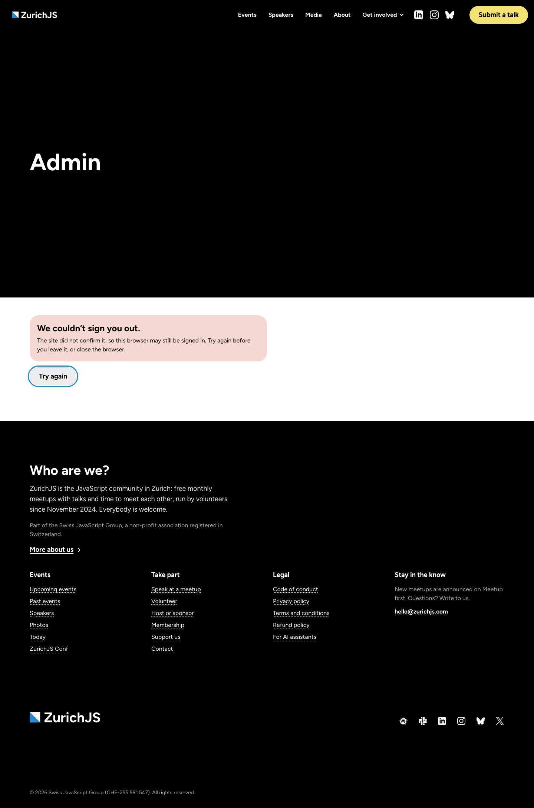
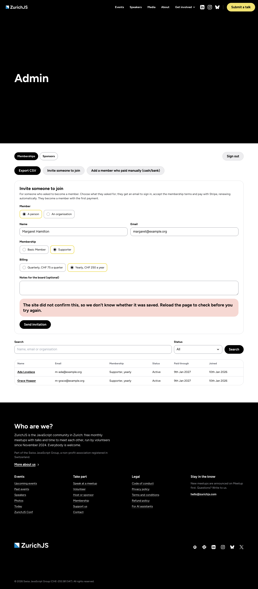
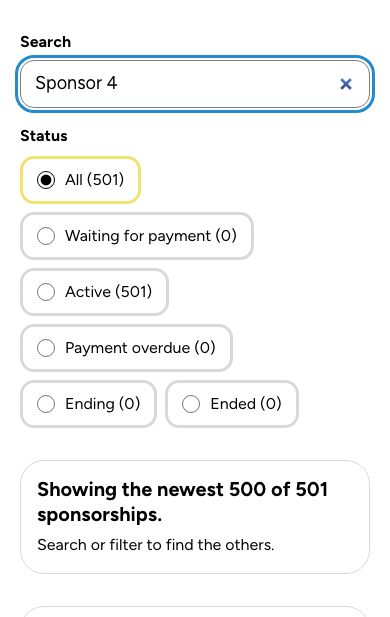
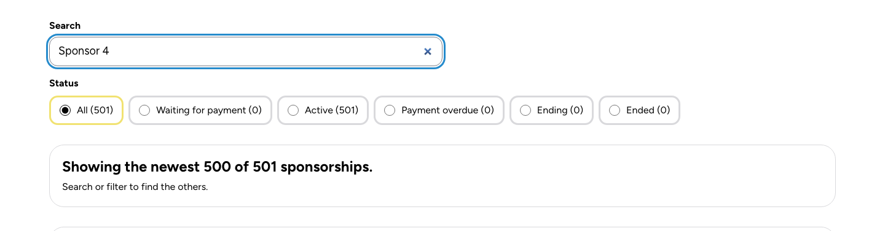

# #97 review fixes: admin sign-out, member answers, write limits

Built with `CONTENT_SOURCE=sample BUILD_NOW=2026-11-01T12:00:00+01:00`, clock fixed at 19th November 2026. **Every API answer is a mock** (Playwright `route.fulfill` / `route.abort`): no real session, member or sponsor data.

Screenshots are full page at 320, 375, 390, 1280 and 1440 px with reduced motion, except the truncated sponsor list: 500 mocked rows are too tall to capture, so that state is an excerpt from the search field to the notice. [`checks.json`](checks.json): 20 captures, no horizontal overflow, Figtree rendered, no page errors, 3 px focus ring on the keyboard-focused button.

| State | What it shows | 390 | 1440 |
| --- | --- | --- | --- |
| `signout-failed` | Logout request dropped: the admin area is hidden, "We couldn’t sign you out." with Try again focused |  |  |
| `member-late-answer-ignored` | Ada opened (answer held), Grace opened, Ada's answer released: Grace stays |  |  |
| `write-outcome-unknown` | Invite answered by an HTML 504: the outcome is unknown, reload before trying again |  |  |
| `sponsors-truncated-label-follows-answer` | Search typed, its answer held: the notice still describes the unfiltered list shown |  |  |

Recordings (1280 × 800, motion on, mocked answers): [`signout-failed-then-retry.mp4`](signout-failed-then-retry.mp4) ([gif](signout-failed-then-retry.gif)) and [`member-late-answer-and-unknown-write.mp4`](member-late-answer-and-unknown-write.mp4) ([gif](member-late-answer-and-unknown-write.gif)).

Fail before: [`e2e-on-old-head-ec7e2c1.log`](e2e-on-old-head-ec7e2c1.log) (4 of 4 new browser tests fail on the old islands), [`unit-on-old-head-ec7e2c1.log`](unit-on-old-head-ec7e2c1.log) (deadline and missing `AbortSignal.timeout`/`any` tests fail).
